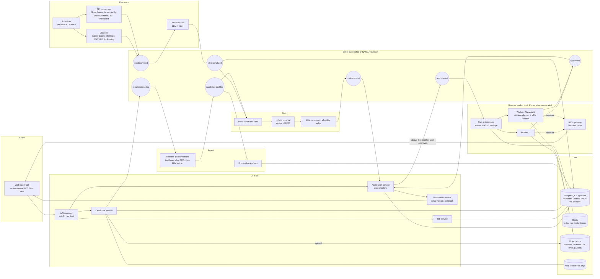

# LAMO Job Engine: architecture for a resume-driven, autonomous job-application system

Status: **design only. Nothing here is built or running.** The LAMO on the portfolio site is a separate, read-only
assistant (`src/lib/lamo/agent.ts`) and stays that way: it has no write tools and no admin power. The job engine below is a
different product that would live in its own repository and its own deployment, and share nothing with the public chatbot.

## 0. Ground rules the design enforces (they are product requirements, not afterthoughts)

| Rule | How the design honours it |
| --- | --- |
| Never invent facts about the candidate | Every form answer must cite a span of the candidate's own resume or profile. No span, no answer: the field goes to the human queue. |
| Never store a user's account passwords | No credential vault for job sites. Logged-in sites are handled by a **user-driven session** (user signs in once in a remote browser view; only the resulting session cookie, encrypted, is kept and expires). The engine never types a password it was given. |
| No LinkedIn scraping or credential automation | LinkedIn is supported only as "user pastes or forwards a job URL / alert email". No crawler, no automated login. Same policy for any site whose terms forbid automation (see 3.3). |
| CAPTCHAs, OTPs, 2FA are never bypassed | The agent stops and hands the live browser to the user (HITL). No solver services, no mail-inbox reading beyond a user-granted forwarding rule. |
| Owner approval for public claims | Each submitted application is rendered as a "frozen packet" (answers + cited evidence) that auto-submit mode may send unseen only above the threshold and only for roles the user opted into. Default mode is **review-then-submit**. |
| Legal and ToS risk | Automating applications is against some sites' terms. The engine ships with a per-domain policy table (`ALLOW_API`, `ALLOW_BROWSER`, `ASSIST_ONLY`, `BLOCKED`), default-deny for unknown domains. |

## 1. System architecture



Services are small and stateless; all state is in Postgres, Redis, or the object store. Every inter-service step is an event, so any stage can be replayed from the log.

## 2. Resume ingestion and knowledge extraction

Pipeline (`resume.uploaded` → `candidate.profiled`):
1. **Detect format.** PDF/DOCX/image. DOCX → text + structure directly. PDF → try the text layer (`pdfium`/`pdfminer`) with coordinates.
2. **Layout-aware fallback.** If text coverage is low or reading order is broken (columns, sidebars, a photo box as in these resumes), render pages at 200 dpi and run layout detection + OCR (PaddleOCR or Tesseract with a layout model). Emit blocks with bounding boxes and a section label (header, education, skills, projects, experience).
3. **Structured extraction.** An LLM with a strict JSON schema (section 5.1) and `temperature=0`. Prompt rule: copy values only from the supplied blocks and return the block ids as `evidence`. Validate with JSON Schema; one repair retry; then a human confirmation screen.
4. **Deterministic cross-checks.** Regex for email/phone/URLs, date parsing, GPA ranges; reject any LLM value not literally present in the source text (hallucination guard).
5. **Inference layer (labelled `inferred`, never mixed with `explicit`).**
   - *Seniority tier*: rules first (graduation year vs today, months of full-time experience, titles), LLM only to break ties. New Grad: ≤ 12 months full-time and graduating within 12 months or less than 24 months ago; Intern-eligible: enrolled with ≥ 6 months left; Mid: 2 to 5 years; Senior: 5+ with scope signals.
   - *Domain verticals* with weights, from a fixed taxonomy (e.g. `robotics.perception`, `robotics.slam`, `ml.deep_learning`, `ml.mlops`, `systems.embedded`) so jobs and candidates share one vocabulary.
   - *Target role taxonomy*: map skills and projects to canonical roles (Autonomous Perception Engineer, ML Engineer, Robotics Software Engineer...).
6. **Embeddings.** One vector per atomic unit (each project, each experience bullet group, a skills summary, a "career narrative"), plus one candidate-level vector. Stored in `pgvector`. Keeping units separate lets matching say *which* project supports a job.
7. **Candidate-confirmed.** The user reviews the extracted profile once; edits are versioned. Nothing is applied with unconfirmed data.

## 3. Job discovery

### 3.1 Source tiers (most to least preferred)
1. **Official APIs / public feeds**: Greenhouse Job Board API, Lever postings API, Ashby, SmartRecruiters, Workday's public JSON job-search endpoint per tenant, YC's job listings, company RSS and `JobPosting` JSON-LD from sitemaps. Structured, stable, allowed.
2. **Polite crawlers** for direct career pages: robots.txt respected, per-host rate limits, conditional GET, ETag/Last-Modified, sitemap diffing.
3. **Headless rendering** (Playwright) only when a page needs JS and its terms allow it.
4. **Assist-only**: LinkedIn and similar. User shares the URL or job-alert email; the engine normalizes and matches it but does not crawl.

### 3.2 Scheduling
A scheduler stores `source`, `cadence`, `last_cursor`, `etag`, `fail_count`. Hot sources (new-grad boards) every 15 min, long tail daily. Each fetch emits `job.discovered{source, url, raw_ref}`. Raw payloads go to the object store; they are the audit trail.

### 3.3 Politeness, rotation, and what rotation is for
Per-domain token buckets in Redis, jittered delays, identifiable User-Agent with a contact URL. Proxy rotation exists to spread load across **our own egress IPs and regions** and to avoid shared-IP bans, not to evade a site that said no. A domain in `BLOCKED` or `ASSIST_ONLY` is never fetched.

### 3.4 Normalization (`job.discovered` → `job.normalized`)
HTML → clean text → LLM extraction into `NormalizedJob` (section 5.2) with rule-based fixers (salary regex, "3+ years", "US citizens only", "sponsorship available"). Every extracted constraint carries `source_quote`. Unknown stays `null` and is treated as "unknown" by the filter, never as "ok". Dedup key: `(canonical_company_id, ats_job_id)` else a hash of `(company, normalized title, location, first 500 normalized chars)`; near-duplicates across boards collapse onto one `job_canonical` row with many `job_source` rows.

## 4. Matching and eligibility

**Stage 1: hard-constraint filter (SQL, cheap).** Drop a job when any known constraint fails:
- experience: `job.min_years <= candidate.total_years + slack` and not `senior+` when the candidate is New Grad (configurable slack);
- location/remote/relocation preference;
- work authorization vs `visa_policy` (`requires_citizenship`, `no_sponsorship`, `sponsors`, `unknown`); `unknown` passes but flags the packet;
- user blocklists (companies, titles, clearance-required roles), already-applied check.

**Stage 2: hybrid retrieval.** Score = `α·cosine(job_vec, best candidate-unit vecs)` + `β·BM25(tech_stack terms)` fused with reciprocal-rank fusion, top N (e.g. 200). Dense vectors capture "SLAM/ROS2/PyTorch ≈ Autonomous Perception Engineer"; BM25 keeps exact tools (CUDA, ROS2, TensorRT) from being washed out.

**Stage 3: LLM re-ranker and eligibility judge.** Input: normalized job + the candidate's confirmed profile + top evidence units. Output (schema-enforced): `score 0-100`, `must_have_coverage[]` (requirement → evidence id or `missing`), `risks[]`, `reasons[]`. Deterministic rules override the LLM: a missing hard requirement caps the score; fabricated evidence ids are rejected. Calibrate the 0-100 score against user accept/reject feedback (isotonic regression) so the threshold means something.

**Triggering.** `auto_apply_threshold` (default 85, per candidate, plus daily cap and per-company cap). Below threshold but above `review_threshold` (default 65): goes to the review queue. A user may switch to full auto only after approving N reviewed packets.

## 5. Core schemas

### 5.1 CandidateProfile (JSON Schema, abridged)
```json
{
  "$id": "CandidateProfile", "type": "object",
  "required": ["candidate_id", "version", "contact", "education", "skills", "preferences"],
  "properties": {
    "candidate_id": {"type": "string", "format": "uuid"},
    "version": {"type": "integer"},
    "contact": {"type": "object", "properties": {
      "full_name": {"type": "string"}, "email": {"type": "string", "format": "email"},
      "phone": {"type": "string"}, "location": {"type": "string"},
      "links": {"type": "object", "properties": {"github": {"type": "string"}, "linkedin": {"type": "string"}, "portfolio": {"type": "string"}}}}},
    "education": {"type": "array", "items": {"type": "object", "properties": {
      "institution": {"type": "string"}, "degree": {"type": "string"}, "field": {"type": "string"},
      "start": {"type": "string"}, "end": {"type": "string"}, "expected": {"type": "boolean"},
      "coursework": {"type": "array", "items": {"type": "string"}}, "evidence": {"type": "array", "items": {"type": "string"}}}}},
    "experience": {"type": "array", "items": {"type": "object", "properties": {
      "org": {"type": "string"}, "title": {"type": "string"}, "start": {"type": "string"}, "end": {"type": ["string", "null"]},
      "employment_type": {"enum": ["full_time", "internship", "contract", "open_source", "research"]},
      "bullets": {"type": "array", "items": {"type": "string"}}, "tech": {"type": "array", "items": {"type": "string"}}}}},
    "projects": {"type": "array", "items": {"type": "object", "properties": {
      "name": {"type": "string"}, "year": {"type": "integer"}, "summary": {"type": "string"},
      "tech": {"type": "array", "items": {"type": "string"}}, "links": {"type": "array", "items": {"type": "string"}},
      "metrics": {"type": "array", "items": {"type": "string"}}, "embedding_id": {"type": "string"}}}},
    "skills": {"type": "array", "items": {"type": "object", "properties": {
      "name": {"type": "string"}, "category": {"type": "string"},
      "proficiency_evidence": {"enum": ["shipped", "project", "coursework", "listed_only"]}}}},
    "inferred": {"type": "object", "properties": {
      "seniority": {"enum": ["intern", "new_grad", "junior", "mid", "senior", "staff"]},
      "total_fulltime_months": {"type": "integer"},
      "domains": {"type": "array", "items": {"type": "object", "properties": {"id": {"type": "string"}, "weight": {"type": "number"}}}},
      "target_roles": {"type": "array", "items": {"type": "string"}},
      "confidence": {"type": "number"}}},
    "preferences": {"type": "object", "properties": {
      "locations": {"type": "array", "items": {"type": "string"}}, "remote": {"enum": ["remote_only", "hybrid_ok", "onsite_ok"]},
      "work_authorization": {"type": "array", "items": {"type": "object", "properties": {"country": {"type": "string"}, "status": {"type": "string"}, "needs_sponsorship": {"type": "boolean"}}}},
      "min_comp": {"type": ["number", "null"]}, "blocked_companies": {"type": "array", "items": {"type": "string"}},
      "auto_apply_threshold": {"type": "integer", "default": 85}, "review_threshold": {"type": "integer", "default": 65},
      "daily_cap": {"type": "integer", "default": 10}}},
    "answer_bank": {"type": "array", "description": "reusable screening answers the user approved", "items": {"type": "object", "properties": {
      "question_key": {"type": "string"}, "answer": {"type": "string"}, "approved_at": {"type": "string"}}}}
  }
}
```
Fields the owner has not supplied (DOB, gender, ethnicity, disability, veteran status, salary history) are **never inferred**; EEO questions default to "Prefer not to say" unless the user set an answer.

### 5.2 NormalizedJob (PostgreSQL)
```sql
CREATE TABLE company (
  id UUID PRIMARY KEY, name TEXT NOT NULL, domain TEXT UNIQUE, ats TEXT,  -- greenhouse|lever|workday|ashby|custom
  policy TEXT NOT NULL DEFAULT 'BLOCKED' CHECK (policy IN ('ALLOW_API','ALLOW_BROWSER','ASSIST_ONLY','BLOCKED'))
);
CREATE TABLE job_canonical (
  id UUID PRIMARY KEY, company_id UUID NOT NULL REFERENCES company(id),
  ats_job_id TEXT, dedupe_hash TEXT NOT NULL,
  title TEXT NOT NULL, title_canonical TEXT,           -- taxonomy role id
  seniority TEXT, employment_type TEXT,
  locations JSONB NOT NULL DEFAULT '[]', remote_mode TEXT,   -- onsite|hybrid|remote|unknown
  min_years NUMERIC, max_years NUMERIC,
  required_stack TEXT[] NOT NULL DEFAULT '{}', preferred_stack TEXT[] NOT NULL DEFAULT '{}',
  domains JSONB NOT NULL DEFAULT '[]',
  visa_policy TEXT NOT NULL DEFAULT 'unknown' CHECK (visa_policy IN ('sponsors','no_sponsorship','requires_citizenship','requires_clearance','unknown')),
  comp_min NUMERIC, comp_max NUMERIC, comp_currency TEXT,
  description_text TEXT NOT NULL, quotes JSONB NOT NULL DEFAULT '{}',   -- field -> source quote
  embedding VECTOR(1024), tsv TSVECTOR GENERATED ALWAYS AS (to_tsvector('english', title || ' ' || description_text)) STORED,
  status TEXT NOT NULL DEFAULT 'open', first_seen TIMESTAMPTZ NOT NULL DEFAULT now(), last_seen TIMESTAMPTZ NOT NULL DEFAULT now(),
  UNIQUE (company_id, ats_job_id), UNIQUE (dedupe_hash)
);
CREATE TABLE job_source (job_id UUID REFERENCES job_canonical(id), source TEXT, url TEXT, raw_ref TEXT, fetched_at TIMESTAMPTZ, PRIMARY KEY (job_id, url));
CREATE INDEX job_vec ON job_canonical USING hnsw (embedding vector_cosine_ops);
CREATE INDEX job_tsv ON job_canonical USING gin (tsv);
```

### 5.3 ApplicationState (PostgreSQL + state machine)
```sql
CREATE TABLE application (
  id UUID PRIMARY KEY, candidate_id UUID NOT NULL, job_id UUID NOT NULL REFERENCES job_canonical(id),
  state TEXT NOT NULL CHECK (state IN ('PARSED','MATCHED','REVIEW','QUEUED','IN_PROGRESS','HITL_PAUSED','SUBMITTED','FAILED','WITHDRAWN','SKIPPED')),
  score INT, score_detail JSONB, packet JSONB,          -- frozen answers + evidence ids
  attempt INT NOT NULL DEFAULT 0, next_attempt_at TIMESTAMPTZ, lease_owner TEXT, lease_until TIMESTAMPTZ,
  hitl_reason TEXT, failure_code TEXT, confirmation_ref TEXT, artifacts JSONB,   -- screenshots, HAR, DOM snapshots
  version INT NOT NULL DEFAULT 0,                       -- optimistic locking
  created_at TIMESTAMPTZ NOT NULL DEFAULT now(), updated_at TIMESTAMPTZ NOT NULL DEFAULT now(),
  UNIQUE (candidate_id, job_id)                         -- hard dedupe
);
-- second dedupe layer: same company + same canonical role family within 90 days
CREATE TABLE application_guard (candidate_id UUID, company_id UUID, title_canonical TEXT, applied_at TIMESTAMPTZ, PRIMARY KEY (candidate_id, company_id, title_canonical));
CREATE TABLE application_event (id BIGSERIAL PRIMARY KEY, application_id UUID, from_state TEXT, to_state TEXT, actor TEXT, detail JSONB, at TIMESTAMPTZ DEFAULT now());
CREATE TABLE credential_session (   -- user-driven session cookies only; no passwords
  id UUID PRIMARY KEY, candidate_id UUID, domain TEXT, enc_blob BYTEA NOT NULL, key_id TEXT NOT NULL, expires_at TIMESTAMPTZ NOT NULL);
```
Allowed transitions (anything else is rejected in one `UPDATE ... WHERE state = $from AND version = $v`):
```
PARSED -> MATCHED -> (REVIEW | QUEUED | SKIPPED)
REVIEW -> QUEUED | SKIPPED
QUEUED -> IN_PROGRESS
IN_PROGRESS -> SUBMITTED | HITL_PAUSED | FAILED | QUEUED (retry)
HITL_PAUSED -> IN_PROGRESS | WITHDRAWN
FAILED -> QUEUED (manual or classified-retryable only)
```
`PARSED` applies to the candidate/job pair stage after both sides are normalized.

## 6. Autonomous browser agent

### 6.1 Worker loop (per application, one isolated browser context)
```
lease(application) -> load packet + profile + site policy -> open context (fresh profile, user session cookies if any)
repeat up to MAX_STEPS:
  1. OBSERVE   accessibility tree (roles, names, states, values) + URL + visible errors; screenshot only on demand
  2. CLASSIFY  page type: landing | login | form_step | review | confirmation | blocked | unknown
  3. PLAN      for form_step: list fields -> for each, choose a FieldBinding (below)
  4. ACT       fill/select/click/upload via Playwright locators from AX nodes (never raw coordinates unless VLM mode)
  5. VERIFY    re-read the tree: value stuck? validation error? new fields? step advanced?
  6. GUARD     stop conditions: captcha/otp/2fa, unknown required field, answer without evidence, policy BLOCKED, loop detected
  7. COMMIT    only on review page, after packet diff check, click Submit; capture confirmation text/id + screenshot
```
### 6.2 Mapping candidate fields to unseen UI
Per field: take `(label, aria-name, placeholder, input type, options, required, nearby text)` → three binders in order:
1. **Rule binder**: normalized label dictionary (`first name`, `phone`, `linkedin url`, `graduation date`...) → profile path. Handles ~70% with no LLM.
2. **Semantic binder**: embed label+options, nearest profile key above a similarity floor; for dropdowns pick the option by exact, then fuzzy, then LLM choose-from-list (must return one of the offered options or `none`).
3. **Open-text RAG binder** (screening questions): retrieve top-k candidate units (projects, experience, answer bank), generate an answer constrained to that evidence, with length limit, and run a **faithfulness check** (every claim must be supported by a retrieved unit; otherwise regenerate once, then escalate). Questions like "Why do you want to work here?" use the job text plus candidate evidence; the first draft is shown to the user in REVIEW mode, and approved answers are stored in `answer_bank`.

Unknown required field, legal attestation ("I certify the above is true"), signature, or salary expectation outside the user's stated range → `HITL_PAUSED` with the field highlighted.
File upload: choose the resume variant (Robotics or AI/ML) by the job's domain score; both are stored per candidate.

### 6.3 VLM fallback
Triggered when the AX tree is empty or unlabeled (canvas forms, heavy custom widgets) or a step fails twice. Take a screenshot with numbered set-of-marks overlays on interactive elements, ask the VLM for `{action, mark_id, value}`, execute, verify with a second screenshot. VLM mode has a lower step budget and never clicks the final Submit; submission is always done by the deterministic COMMIT step.

### 6.4 HITL interruption handler
Detection: known CAPTCHA frames (reCAPTCHA, hCaptcha, Turnstile), OTP/2FA text patterns, "verify it's you" pages, unexpected logout. Action: freeze the page (keep the browser context alive for up to 30 minutes), set `HITL_PAUSED` with reason, notify the user (push/email) with a one-tap link to a **live view** (WebRTC or noVNC relay through the HITL gateway, token-scoped to that session). The user solves it; the worker resumes from the same DOM state. Timeout → state back to `QUEUED` with a fresh attempt, or `WITHDRAWN` if the user declines. No solver services, no reading the user's mailbox beyond a forwarding rule they set up for OTP-free flows.

## 7. Orchestration, reliability, guardrails

- **Bus**: Kafka (or NATS JetStream for the single-node profile). Topics partitioned by `candidate_id` so one candidate's events stay ordered. At-least-once delivery; consumers are idempotent through an outbox table and `event_id` dedupe.
- **Leases**: Redis `SET lease:{app} owner NX PX 120000`, heartbeat every 30 s. A crashed worker's lease expires and the sweeper re-queues. Postgres `version` is the source of truth; Redis only coordinates.
- **Dedupe**: `UNIQUE(candidate_id, job_id)`, `application_guard` (company + role family window), and a final pre-submit check against `application_guard` inside the same transaction as the move to `SUBMITTED`. Cross-board duplicates are already collapsed in `job_canonical`.
- **Retries**: classify failures. `TRANSIENT` (timeouts, 5xx, navigation errors) → exponential backoff with jitter `min(cap, base·2^attempt) ± 20%`, max 5. `STRUCTURAL` (form changed, unknown required field) → 1 retry with VLM fallback, then HITL. `FATAL` (job closed, ineligible, policy blocked) → `FAILED`, no retry. Poison messages go to a dead-letter topic.
- **Proxies**: residential or datacenter egress pools chosen per domain policy, sticky per application so one application never changes IP mid-flow; health-scored and rotated on bans. Region-matched to the candidate's location to avoid fraud flags.
- **Rate limits**: per-domain and per-candidate token buckets in Redis; the daily cap prevents spray applications.
- **PII and secrets**: AES-256-GCM envelope encryption. Per-tenant data keys wrapped by KMS (AWS KMS, GCP KMS, or Cloudflare/Vault transit); decrypted only in worker memory for the life of a run. Resume files in the object store use SSE-KMS. Logs redact emails, phones, and form values. HAR files and screenshots are encrypted and expire after N days. Session cookies expire and are deleted on user request.
- **Guardrails**: output schema validation on every LLM call; evidence required for every factual claim; prompt-injection defence for job text (it is treated as untrusted data, never as instructions; the browser agent cannot navigate off the policy-allowed domains, download files, or run scripts from page text).
- **Observability**: OpenTelemetry traces keyed by `application_id`; metrics for submit success rate by ATS, HITL rate, mean steps per form, answer-faithfulness failures; every state change in `application_event`; a per-ATS "form drift" alert when success rate drops.
- **Kill switch**: global and per-candidate pause that stops leasing new applications immediately.

## 8. End-to-end walkthrough (Robotics candidate, unseen ATS)
1. Candidate uploads the Robotics resume. Parser finds the text layer, ignores the circular photo, extracts projects (PinnFlow, a detection pipeline), skills (PyTorch, ONNX, ROS2...), education (B.Tech CSE-AI, expected 2028). Seniority = `intern` / `new_grad` pipeline by dates; domains = robotics.perception 0.5, ml.deep_learning 0.4. User confirms.
2. Scheduler pulls Greenhouse/Lever feeds; the normalizer turns "Autonomous Perception Engineer, 0-2 yrs, Bengaluru/remote, sponsorship N/A" into a `NormalizedJob`.
3. Filter passes (experience 0-2, location ok, authorization ok). Hybrid retrieval ranks it high (project vectors near "perception", BM25 hits ROS2/PyTorch). Re-ranker returns 88 with evidence for each must-have and one `missing` nice-to-have.
4. 88 ≥ 85 and the company is on `ALLOW_BROWSER`: `QUEUED`. The orchestrator leases a worker; state `IN_PROGRESS`.
5. Worker opens the apply URL. Page 1: AX tree shows name/email/phone/resume upload; the rule binder fills them; the upload picks the Robotics PDF. Verify passes; it clicks Next.
6. Page 2: an unseen custom dropdown "Notice period" (options: Immediate, 15 days, 30 days...). Semantic binder maps it to the profile's availability; the LLM picks from the options only.
7. Page 3: "Describe a challenging ML deployment." RAG pulls the FastAPI/ONNX latency project; the answer cites it; faithfulness check passes; the draft is stored.
8. Page 4: reCAPTCHA appears. Guard → `HITL_PAUSED`; the user gets a push, solves it in the live view, the worker resumes.
9. Review page: packet diff (what we filled vs the frozen packet) matches; COMMIT clicks Submit; the confirmation id and screenshot are stored; the transaction writes `SUBMITTED` + `application_guard`. A second job at the same company with the same role family inside 90 days is skipped.

## 9. Stack and scaling

| Concern | Choice | Why |
| --- | --- | --- |
| API and workers | TypeScript (Node) for services and Playwright workers; Python for parsing/ML workers | Playwright is first-class in Node; the OCR/ML ecosystem is Python. Both talk through the bus. |
| Relational + vector + keyword | PostgreSQL + pgvector + `tsvector` | One system covers transactions, state machine, hybrid search up to tens of millions of rows. Move vectors to Qdrant/OpenSearch only when needed. |
| Queue | NATS JetStream (single node) → Kafka (multi-tenant) | Same event contracts; swap the adapter. RabbitMQ also works if per-message routing matters more than replay. |
| Locks / rate limits | Redis | Atomic leases and token buckets. |
| Files | S3-compatible object store | Resumes, screenshots, HAR, raw JDs. |
| LLMs | Small model for classification/normalization, strong model for re-rank and answers, VLM only as fallback; all behind one gateway with caching and budgets | Cost control; 80% of calls hit the small model. |
| Browser pool | Containers running headful-in-Xvfb Chromium, one context per application, on Kubernetes with KEDA autoscaling on queue depth | Crash isolation, easy to scale to thousands. |
| Secrets | KMS envelope encryption | Meets AES-256 requirement without handling raw keys in app code. |

**Scaling path.**
1. *Single-user local agent*: one process, SQLite (or Postgres in Docker), in-process queue, 1 to 2 local browsers, the user's own IP and own display (HITL is simply "the window is already on your screen"). Same schemas and state machine.
2. *Small hosted*: Postgres + Redis + NATS, a handful of worker pods, per-tenant rate limits.
3. *Multi-tenant platform*: Kafka partitioned by candidate, Postgres read replicas then sharding by `tenant_id`, separate worker pools per ATS (so a Workday outage cannot starve Greenhouse), per-tenant KMS keys, per-tenant concurrency quotas, regional worker fleets. A browser session costs ~300 to 600 MB; 2,000 concurrent sessions ≈ 1 TB RAM across ~60 nodes, so the scheduler also batches by ATS to reuse warm browsers, and the dominant cost control is the 3-stage filter that keeps applications for matches only.
Bottlenecks to watch: LLM spend per application (cache normalizations per job, not per candidate), per-domain rate limits (shared across tenants, enforced centrally), and form drift (a per-ATS regression suite of recorded forms in CI).

## 10. Build order (what to do first)
1. Schemas + resume parser + candidate review screen (no automation yet).
2. Greenhouse/Lever/Ashby connectors + normalizer + matching, output as a ranked list.
3. Review-then-submit worker for Greenhouse and Lever only (public, stable forms), HITL, dedupe.
4. Open-text RAG answers, answer bank, VLM fallback.
5. Auto-apply above threshold, quotas, multi-tenant hardening.
